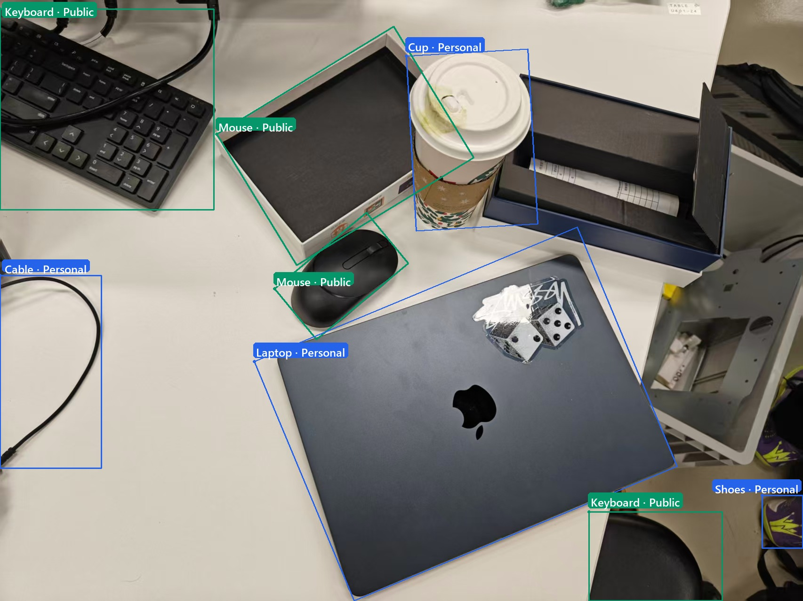
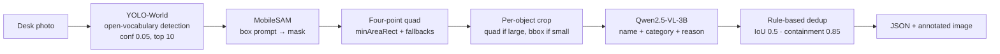
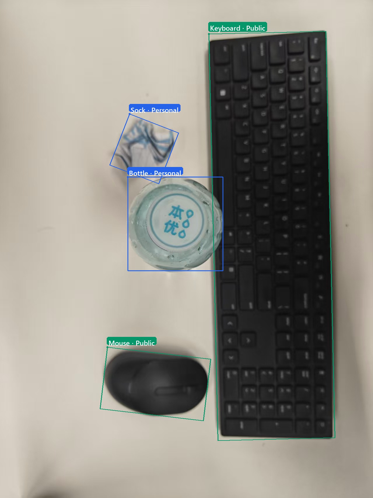
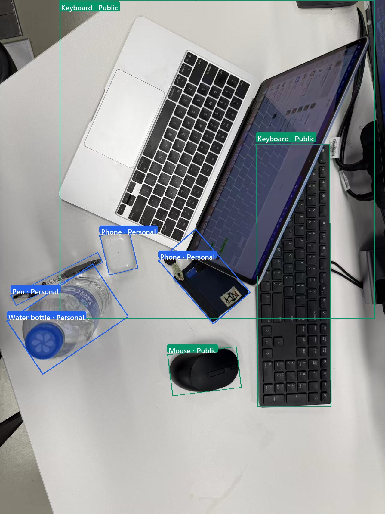
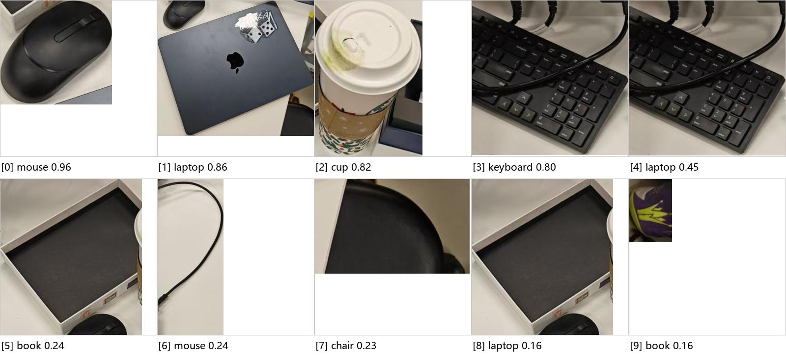
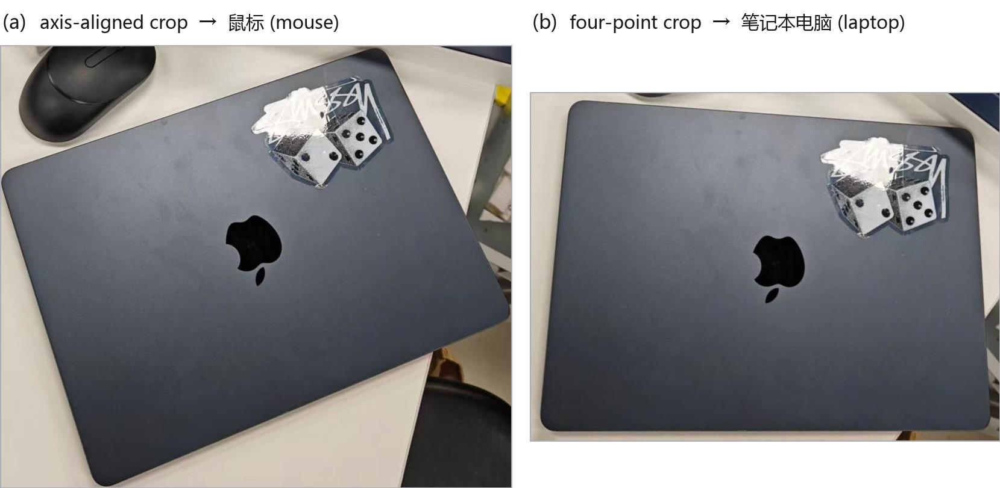

# Desk Object Detection & Three-Class Classification

Perception stage of a library service robot: given **one photograph of a desk**, find every
object on it, localise it with a four-point box, and label it **public property**, **personal
property** or **waste** — so the robot knows where each item should go.

`YOLO-World` localises · `MobileSAM` sharpens the geometry · `Qwen2.5-VL-3B` names and classifies.
The whole thing runs on a single 8 GB laptop GPU at about 12 s per image.



## Context

This repository is my individual contribution to a group design project (IC382, Group A06).
The group is building a robot that navigates a library floor, decides whether a desk is
occupied, and — once a desk is free — clears it. That last step is this repository: the robot
never sees a desktop except through the JSON this pipeline emits.

The three categories map directly onto actions: public property goes back where it belongs,
personal property goes to lost property, waste goes in the bin. Two things follow from that.
A missed object is permanently invisible to the robot, while a wrong label is recoverable, so
**recall comes first and classification second**. And the objects are never known in advance —
the robot cannot be told to look for a bottle — so the detector has to be open-vocabulary.

## Pipeline



| Stage | What it does | Why it is a separate stage |
|---|---|---|
| **A. Localise** | YOLO-World, confidence 0.05, ten best candidates kept | A dedicated detector has far better recall than asking a 3B VLM to emit boxes, and it is deterministic enough to debug |
| **B. Sharpen** | Each box prompts MobileSAM; the mask contour gives a minimum-area rectangle, i.e. a four-point quad | An axis-aligned box swallows neighbours whenever an object is tilted; a quad hugs it (the masks cost about 0.1 s) |
| **C. Recognise** | Each crop goes to Qwen2.5-VL-3B in one batch; output is `{name, category, reason}` | Naming is a semantic task, which is exactly what a VLM is good at; localisation is not |
| **D. Deduplicate** | Same-name boxes with IoU > 0.5 merge; a same-name box ≥ 85 % inside a larger one is dropped as a child | Allows earlier stages to over-propose: 10 candidates become 7–8 objects |

Two fallbacks keep the geometry honest. Objects larger than 20 % of the image, or whose mask
leaks more than 5 % outside the detector box, keep an axis-aligned box instead of a quad,
because a tight quad on an incomplete mask is worse than a loose box.

## Results

Three photographs of real desks, 1279×1706 to 1706×1279, measured on an RTX 4060 Laptop (8 GB).
Timings are per image **after** the model is resident; the first image additionally pays about
10 s of model loading.

| Image | Scene | Candidates | Objects kept | bf16 | 4-bit |
|---|---|---|---|---|---|
| `6.jpeg` | one keyboard, one mouse, a bottle, a tissue | 6 | **4** | 13.0 s | 5.6 s |
| `1.jpg` | a full working desk, two keyboards, two mice | 10 | **8** | 12.2 s | 5.3 s |
| `2.jpg` | a cluttered desk with a phone and a pen | 10 | **7** | 11.2 s | 5.4 s |


*6.jpeg — the simple validation scene: four objects, quads where the mask is clean.*


*2.jpg — ten candidates reduced to seven objects by the closing rules.*

The most useful diagnostic turned out to be the candidate grid rather than the final output:
it shows exactly which proposals the recognition stage had to reject.



### The fix that mattered most

For a long time the four-point geometry was correct but the VLM was still fed an axis-aligned
crop, so the improvement never reached the model. Feeding the perspective-corrected crop instead
fixed the laptop misclassification — and, applied to everything, broke the bottle and the phone
by zooming in too far. The shipped policy applies quads only above an area threshold.



## Design decisions

1. **The VLM never localises.** All boxes come from the detector and the segmenter. Qwen only
   reads a crop that has already been cut, which is the task a 3B model is reliable at. Earlier
   versions that asked Qwen for boxes produced drifting coordinates and missed objects.
2. **Four-point boxes, but not for everything.** Tight quads help large objects and hurt small
   ones, so the crop policy is size-dependent (`--crop auto`, default).
3. **Deduplicate last, and conservatively.** Geometric deduplication cannot distinguish "the
   same keyboard detected twice" from "a bottle in front of a keyboard", so the rules are
   deliberately narrow and `unknown` labels never merge.
4. **Quantisation stays optional.** 4-bit roughly halves the runtime (5.3 s vs 12.2 s) and
   measurably degrades names, so bf16 remains the default and `--quant 4bit` is a flag.
5. **Every version changes one variable.** Eleven versions in one week, each with a written
   note on the failure that motivated it — see [VERSION_HISTORY.md](src/versions/VERSION_HISTORY.md).

## Quick start

```bash
python -m venv .venv && . .venv/bin/activate     # Windows: .venv\Scripts\activate
pip install -r requirements.txt

# single image
python src/detect.py --image samples/6.jpeg

# several images, Qwen loaded once
python src/detect.py --images samples/6.jpeg samples/1.jpg samples/2.jpg --tag demo

# optional: 4-bit, and keep the crops that were actually sent to Qwen
python src/detect.py --image samples/1.jpg --quant 4bit --save-crops out/crops
```

Outputs are written next to the script: `detection_result_v1.1_<tag>_<image>.json` and
`<image>_annotated_v1.1<tag>.jpg`. Both checkpoints — `yolov8s-worldv2.pt` and `mobile_sam.pt` —
are downloaded automatically by Ultralytics on first run; neither is committed here.

Useful flags: `--crop {auto,quad,bbox}`, `--max-edge 448`, `--batch-size 10`,
`--max-new-tokens 128`, `--conf 0.05`, `--no-quad`, `--save-raw`.

> One small change versus the submitted version: relative image paths are resolved against the
> working directory first, then the script directory (upstream resolved against the script
> directory only). Everything else is the code that produced the recorded results.

## Repository layout

```
.
├── src/
│   ├── detect.py              # final pipeline (v1.1)
│   └── versions/              # every iteration v0.0 → v1.0 + VERSION_HISTORY.md
├── docs/
│   ├── figures/               # outputs used in this README
│   ├── prompts.md             # prompt history, one entry per revision
│   └── *.md                   # design notes and open questions (Chinese)
├── results/                   # recorded runs: v0.9 bf16, v0.9 4-bit, v1.0 (auto and quad)
│                              # + object_classification.json, the hand-made ground truth for 6.jpeg
├── samples/                   # the three test photographs
├── requirements.txt
└── README.md
```

## Limitations

- **No quantitative benchmark.** Three photographs, no labelled test set: the numbers above are
  object counts and latencies, not recall or precision. Several versions "improved" one image
  and quietly damaged another; only re-checking all three caught it.
- **Semantic errors persist.** The crumpled tissue in `6.jpeg` is still read as "sock", and
  4-bit runs produce more of these errors than bf16. The categories inherit them.
- **Large and occluded objects fall back to loose boxes**, so the tight-geometry claim only
  holds for objects that segment cleanly.
- **The waste rule is not fully settled.** An early brief classified waste by *value* ("may be
  discarded freely", so a full water bottle counts), while the shipped prompt classifies by
  *placement and state* ("does not look discarded"). The two rules disagree on exactly the
  borderline items a real robot meets; the shipped one judges placement and state, and
  explicitly forbids calling something waste merely because it is a bottle or a piece of paper.
- **Chinese labels only**, and the rendering step uses Windows fonts (`msyh.ttc`).
- **Geometric deduplication cannot express occlusion.** Two objects in front of one another
  overlap exactly like one object detected twice. Doing this properly means a semantic
  "is this the same object?" step, which was not shipped.

## What I would do next

1. A labelled evaluation set — even 30 photographs — with a stated rule for occluded objects,
   then report recall/precision instead of anecdotes.
2. Name normalisation and a category whitelist, so "sock" and "tissue" cannot silently become
   different categories.
3. Move deduplication from IoU to a semantic check on the crops (the VLM already sees them).
4. Keep the models resident and expose the pipeline as a service, since model loading is 10 s of
   every cold run.
5. Re-test the trade-offs on a 7B model, which should make the four-point/bbox policy less
   critical.

## Design notes

The `docs/` folder holds the working notes written during the project (in Chinese). They are the
actual record of the decisions above, including the options that were rejected:

| File | Topic |
|---|---|
| [`prompts.md`](docs/prompts.md) | Every prompt revision, with the failure that forced it |
| [`garbage_handling.md`](docs/garbage_handling.md) | What "waste" means; six candidate strategies and the chosen one |
| [`detection_stage.md`](docs/detection_stage.md), [`detection_concerns.md`](docs/detection_concerns.md) | Why asking the VLM to detect failed, and the move to a detector |
| [`yolo_world_plan.md`](docs/yolo_world_plan.md) | Detector selection, thresholds, and the two-model memory strategy |
| [`mask_outline_concerns.md`](docs/mask_outline_concerns.md) | What segmentation can and cannot fix (containment vs incompleteness) |
| [`occlusion_concerns.md`](docs/occlusion_concerns.md) | Why IoU deduplication breaks under occlusion |
| [`multi_image_concerns.md`](docs/multi_image_concerns.md) | Three failed multi-image experiments; why single-image was pursued |
| [`learn_from_recognize_v2.md`](docs/learn_from_recognize_v2.md) | What a single-shot VLM baseline teaches (and why it misses objects) |
| [`detection_plan.md`](docs/detection_plan.md), [`v0.4_plan.md`](docs/v0.4_plan.md), [`v0.5_plan.md`](docs/v0.5_plan.md) | Plans for individual stages |

## Acknowledgements

Built on [YOLO-World](https://arxiv.org/abs/2401.17270) (Cheng et al., CVPR 2024) via
[Ultralytics](https://docs.ultralytics.com), [MobileSAM](https://arxiv.org/abs/2306.14289)
(Zhang et al., 2023), and [Qwen2.5-VL](https://arxiv.org/abs/2502.13923) (Bai et al., 2025).
The 4-bit mode uses the NF4 quantisation from [QLoRA](https://arxiv.org/abs/2305.14314)
(Dettmers et al., 2023) through `bitsandbytes`.

## Licence and use

This is coursework; there is no licence for reuse of the code. The models keep their own
licences: YOLO-World and the Ultralytics wrappers are AGPL-3.0, Qwen2.5-VL and MobileSAM are
Apache-2.0. AI assistants were used to debug library-version incompatibilities and to improve
the wording of this README; the design, the runs and the interpretation are mine.
